# Dio File Manager

A small file manager for Windows, written in C and modelled on GNOME Files (Nautilus).
It is a single executable of under 800 KB.

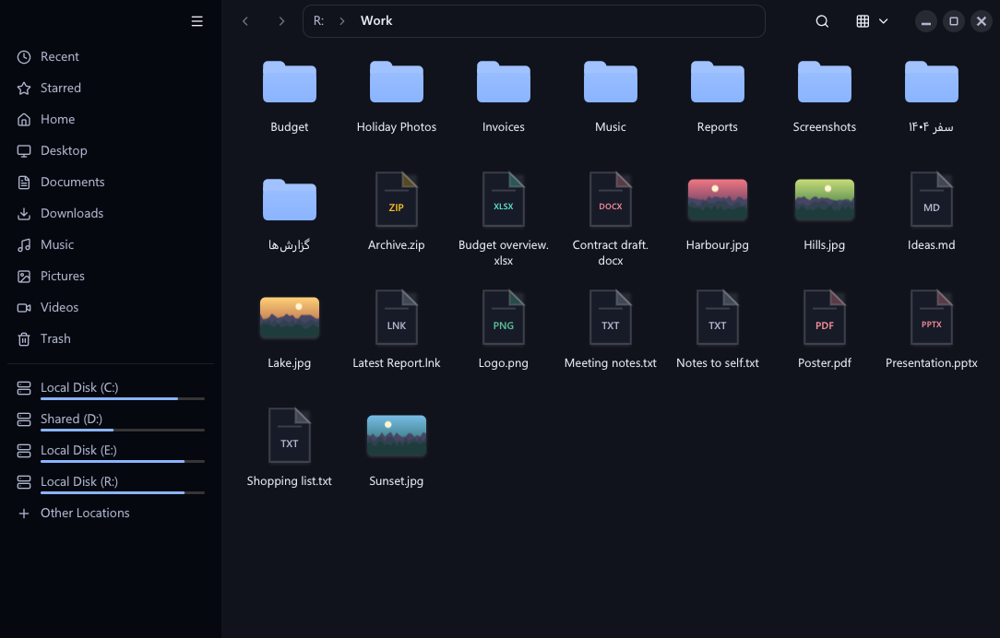

## What it looks like

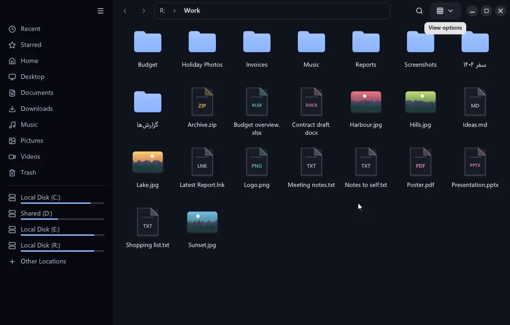

The view menu's zoom slider moves from large icons to the list view and back in one continuous drag.

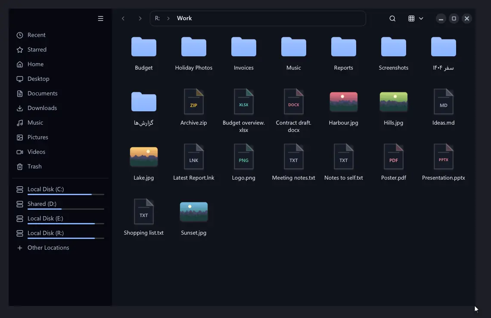

Making the window narrower reflows the grid as you drag; the sidebar slides away when there is no room for it and back when there is.

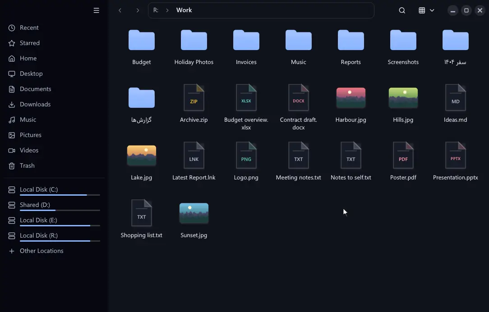

Everyday work: a box selects three files, Ctrl+X and Ctrl+V move them into another folder, and Back returns.

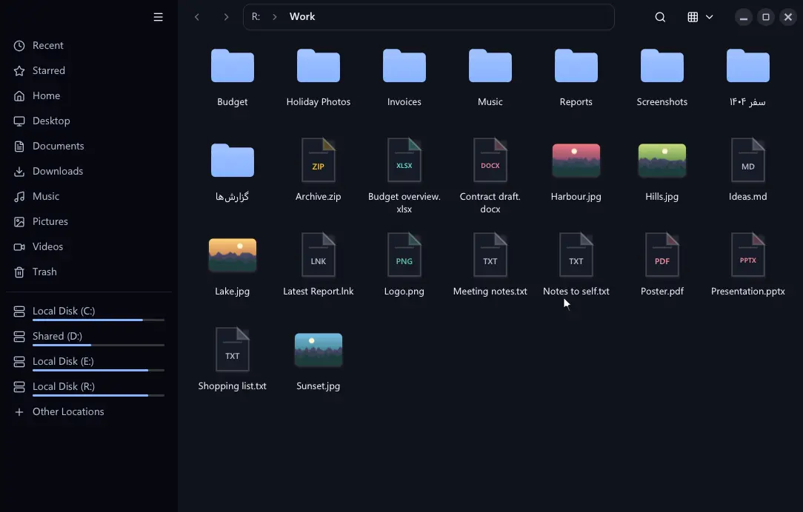

Search looks in the folder and everything below it. Open File Location on a shortcut jumps to the file it points to.

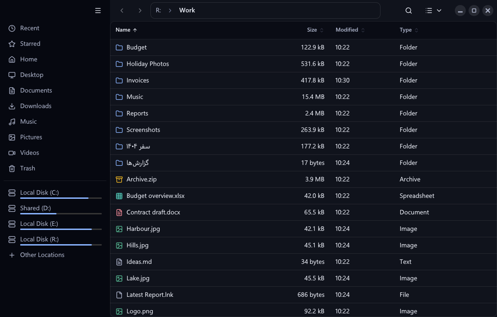

The list view shows the size of each folder, measured in the background.

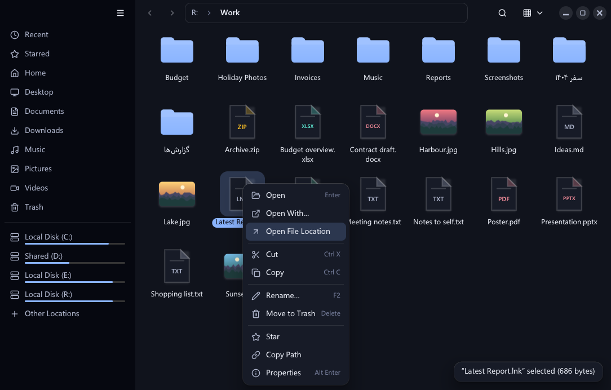

A right-click menu on a shortcut; Open File Location jumps to the file it points to.

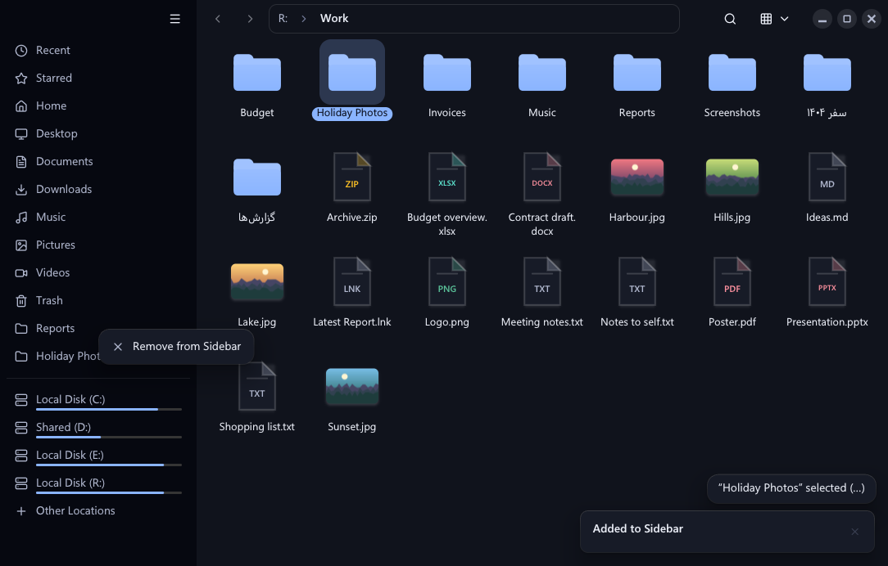

Any folder can be added to the sidebar and removed from it again with a right click.

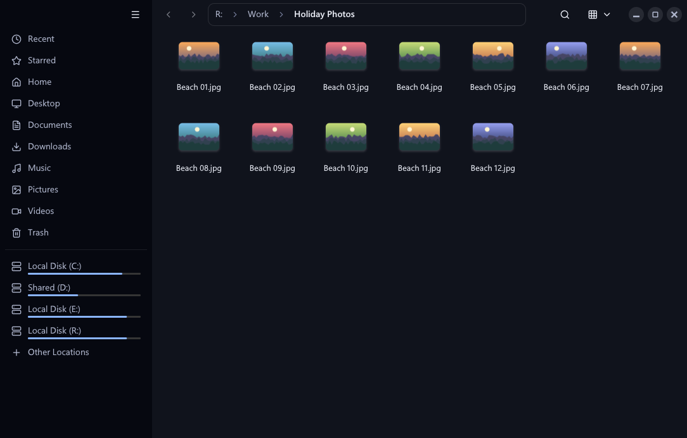

Picture thumbnails.

**Light theme.** The window follows the Windows light or dark setting. The same views in the light theme:

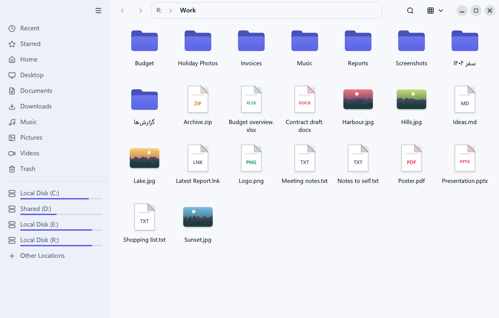

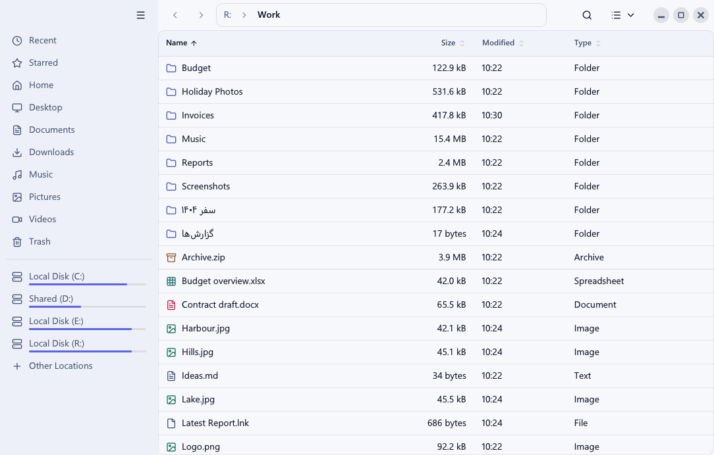

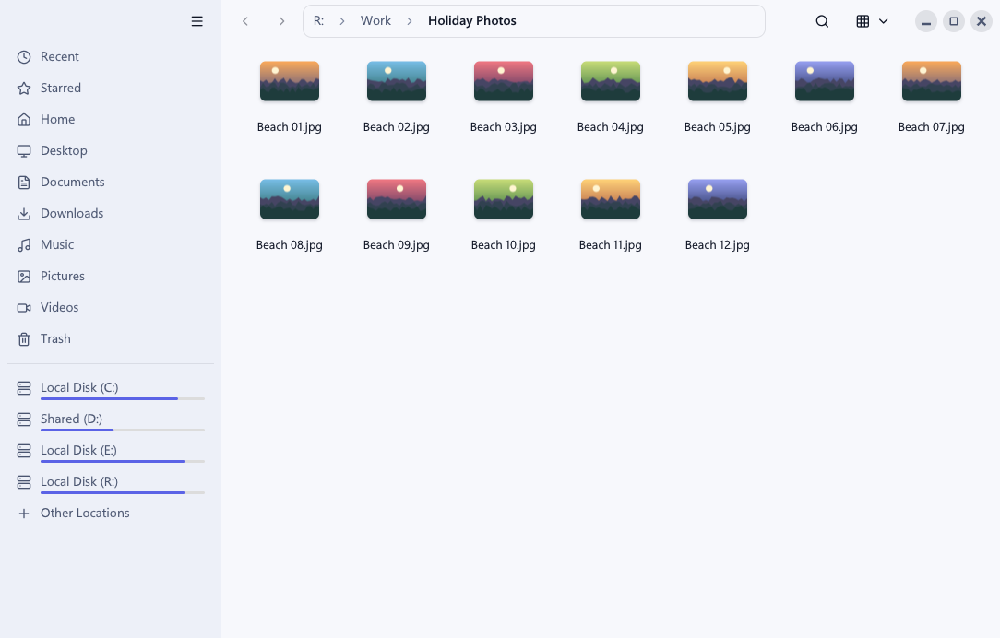

## What it does

- Grid view with four icon sizes and a list view (Name, Size, Modified, Type), joined by one continuous zoom slider.
- Folder sizes in the list view, measured on background threads so the window never waits.
- A sidebar with Recent, Starred, Trash, your folders and your drives, each drive with a bar showing how full it is. Add or remove any row. Removable drives have an Eject button.
- Copy, move, rename, new folder and Move to Trash with Undo, on worker threads, with a progress ring and a dialog for name conflicts (Replace, Keep Both, Skip).
- Drag files out to other programs and drop files in.
- Select with a box, with Ctrl and click, or with the keyboard.
- Search inside a folder and everything below it.
- Open With, Open in Terminal, Properties, Copy Path, and Open File Location for shortcuts.
- The folder you are looking at updates by itself when files are added, renamed or removed.
- Picture thumbnails, and file and folder names in any language.
- Back and forward with Alt+Left and Alt+Right or the mouse buttons, and a path bar you can type in (Ctrl+L).
- Optional: use it as the program Windows opens folders with, Win+E included. It can be switched off again and restores the previous setting exactly.

## Install and start

There is no download yet; you build it from source. Developed and tested on Windows 11 (x64).

You need:

- Visual Studio 2022 or its Build Tools, with the "Desktop development with C++" workload (the MSVC compiler)
- CMake 3.14 or newer
- Git, and an internet connection for the first build: it downloads the UI library the app is built on, [CUI](https://github.com/yappologistic/CUI) (MIT licence), at a fixed commit

Build, from a PowerShell window in the repository folder:

```powershell
cmake -S . -B build -G "Visual Studio 17 2022" -A x64
cmake --build build --config MinSizeRel --target dio-file-manager -j 8
```

The build fails if the executable grows past 800 KB. You can already run it from `build\MinSizeRel\dio-file-manager.exe`.

To install it for your Windows user (no administrator rights needed), copy it to a folder of your own and add a Start menu entry:

```powershell
$install = Join-Path $env:LOCALAPPDATA 'Programs\Dio File Manager'
New-Item -ItemType Directory -Force $install | Out-Null
$exe = Join-Path $install 'dio-file-manager.exe'
Copy-Item -LiteralPath 'build\MinSizeRel\dio-file-manager.exe' -Destination $exe -Force
$shell = New-Object -ComObject WScript.Shell
$shortcut = $shell.CreateShortcut((Join-Path $env:APPDATA 'Microsoft\Windows\Start Menu\Programs\Dio File Manager.lnk'))
$shortcut.TargetPath = $exe
$shortcut.WorkingDirectory = $install
$shortcut.IconLocation = "$exe,0"
$shortcut.Save()
```

Then open **Dio File Manager** from the Start menu. It opens your Home folder in grid view.

To update while a window is open, rename the running `dio-file-manager.exe` to `dio-file-manager.old.exe`, then copy the new one to the normal path.

### Command line

- `--path DIR` starts in a folder.
- `--view grid` or `--view list` picks the view; `--theme light` or `--theme dark` picks the theme.
- `--shot OUT.png` draws the window into a picture file without showing it. It also takes `--size WxH` and `--select NAME`.

## Development

The code is in `src/`. The window is built with CUI; the file work (copying, trashing, searching, folder sizes) lives in separate modules that never call the UI library.

`tests/` holds console tests, which build with the app and run with CTest (`ctest --test-dir build -C MinSizeRel`), and real-input checks that drive the window with Win32 mouse and keyboard messages on a hidden desktop. Those checks use helper tools that are not in this repository, so for now they only run on the author's machine. They keep their files under `.agent-work/`, which git ignores.

## License

MIT. See [LICENSE](LICENSE).
